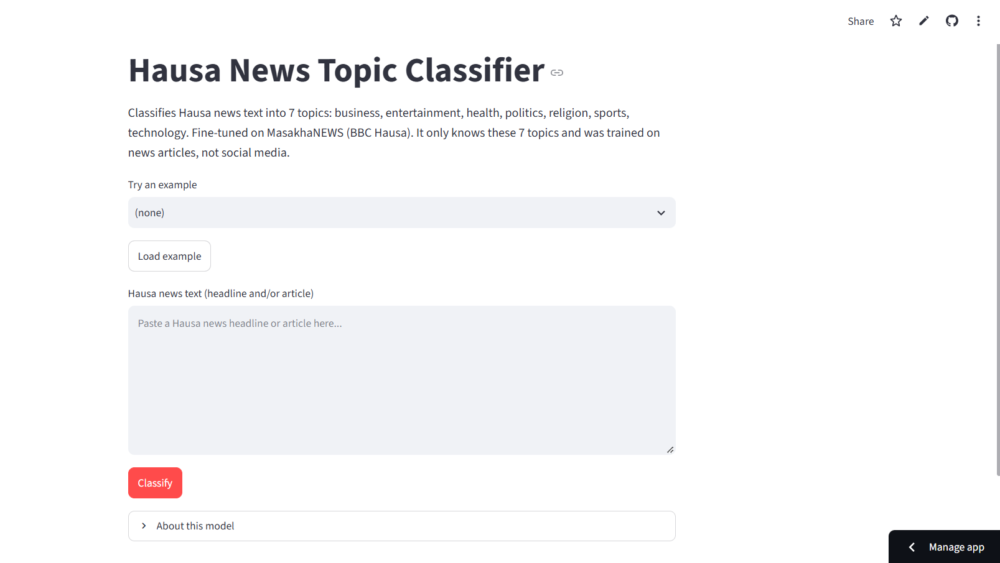

# Hausa News Topic Classification

Individual NLP capstone (Option 3: text classification for an African language).
The system classifies Hausa news text into seven topics: **business, entertainment, health, politics, religion, sports, technology**.

## Project links

| Resource | Link |
|---|---|
| Live app (Streamlit) | https://hausa-news-classification-dz8lsy3zgsb3nqniodefce.streamlit.app/ |
| Demo video | https://go.screenpal.com/watch/cO6FQ2nyDbK |
| Report (PDF) |  |
| Fine-tuned model (Hugging Face Hub) | https://huggingface.co/Batonicarla1/hausa-news-classifier |

The free Streamlit app goes to sleep when nobody uses it. If it shows a "wake up" button, click it and wait about a minute. The first start also downloads the model (about 1 GB), so allow a few minutes.

## Summary of results (test set, 637 articles)

| Model | Test accuracy | Test macro-F1 |
|---|---|---|
| TF-IDF + Logistic Regression (C=10), **baseline** | 0.887 | 0.875 |
| TF-IDF word+char + linear SVM | 0.892 | 0.880 |
| BiLSTM + Word2Vec (best recurrent model) | 0.879 | 0.864 |
| **AfroXLMR-base fine-tuned (final model)** | **0.906** | **0.898** |

Once the final model was selected, we used the test set once per final model to validate the macro-F1 measure. The means and standard deviations in the report (Section 6) are based on seeds.  


## 1. Problem and motivation

In West Africa, Hausa is a pervasive language; very few labelled resources are available for automatic text classification in this language. Construction and Testing of a Hausa news topic classifier; comparison between Classical models and Recurrent models with a Transformer model; Hausa text classification error analysis; and deployment of the best model in a web application for anyone to paste Hausa text and get a predicted topic

## 2. Dataset

We loaded the Hausa portion of MasakhaNEWS (Adelani et al., 2023) from the Hugging Face Hub (masakhane/masakhanews). The articles were taken from BBC Hausa.
Splits: official train / validation / test = 2,219 / 317 / 637 articles.
Classes: 7 topics. In the training set, the respective percentages for entertainment, politics, sports, health, and religion apply to 15.5% to 15.8%, business to 12.6%, and technology to 9.1%. The average length of articles is approximately 448 words.
Headline + body, no URLs - whitespace normalised. No blank texts, no duplicates in the training set, and no splits overlap.
Common problems/challenges: one single news outlet, time-specific vocabulary, hooked letters (ɓ ɗ ƙ ƴ), and the FEFF character written inconsistently in about 7.8% of test articles, some ambiguous terminology (mostly in the business class).
Synthetic and machine-generated data were not used.


## 3. Methodology

| Stage | Notebook | What it does |
|---|---|---|
| Data exploration | `notebooks/01_data_exploration.ipynb` | Dataset statistics, quality checks, cleaning, saving the splits |
| Baselines | `notebooks/02_baseline_tfidf.ipynb` | Majority class; TF-IDF with logistic regression or SVM, tuned on validation macro-F1; Hausa preprocessing experiment |
| Neural models | `notebooks/03_neural_embeddings.ipynb` | BiLSTM / BiGRU with Word2Vec, fastText or random embeddings; seeds and frozen-embedding ablation |
| Transformers | `notebooks/04_transformer_finetune.ipynb` | Fine-tuning AfroXLMR-base, AfriBERTa-base and an XLM-R control; truncation, length and learning-rate experiments; seeds |
| Error analysis | `notebooks/05_error_analysis.ipynb` | Per-class results, confidence analysis, bootstrap test, manually annotated errors |
| Deployment | `notebooks/06_deployment.ipynb` | Model upload to the Hub, app files, tests |

**Baseline.** Word 1-2-gram TF-IDF with logistic regression (C = 10), selected from a grid of logistic regression and word+char SVM models by validation macro-F1.

**Recurrent models.** 200-dimensional skip-gram Word2Vec or fastText embeddings trained on the training split only; BiLSTM or BiGRU (hidden size 128 per direction); max and mean pooling; dropout 0.4; AdamW (learning rate 1e-3, weight decay 0.01); gradient clipping 1.0; batch size 32; early stopping with patience 5; maximum length 400 tokens.

**Transformer.** `Davlan/afro-xlmr-base` with a classification head; maximum length 256 (head truncation); AdamW with learning rate 1e-5 (chosen from a sweep) and weight decay 0.01; batch size 16; linear warmup over 10% of steps then linear decay; gradient clipping 1.0; mixed precision; at most 6 epochs with patience 3.

## 4. Experiments (validation macro-F1)

| Experiment | Val macro-F1 |
|---|---|
| TF-IDF + LogReg (C=10), baseline | 0.912 |
| TF-IDF word+char + SVM | 0.901 |
| BiLSTM + Word2Vec | 0.904 |
| BiGRU + Word2Vec | 0.883 |
| AfriBERTa-base | 0.905 |
| XLM-R-base (control) | 0.890 |
| AfroXLMR-base, head 256, lr 2e-5 | 0.912 |
| AfroXLMR-base, head+tail 256 | 0.907 |
| AfroXLMR-base, head 512 | 0.904 |
| **AfroXLMR-base, head 256, lr 1e-5 (final)** | **0.917** |

Differences of about 0.01 are within epoch-to-epoch and seed variation, so I do not claim that small differences matter. The full table, seed results, and the preprocessing experiment are in `results/` and the report.


## 5. Error analysis

The final model makes 60 errors on 637 test articles (9.4%). Most of these are in the business class; for instance, health, politics, or Religion were predicted as business. Common examples are vague topics, topics in other digest articles, and topic words that are linked to a different topic (an economics article about the Hajj being predicted as a religion class). Longer articles (truncation) have higher error rates, and articles with hooked letters (11.0% vs 6.4%) and articles with a word-initial apostrophe (' yan, 12.9% vs 4.8%) also have higher error rates. These are correlations, NOT cause-and-effect relationships 


## 6. Deployment

The web app lives on Streamlit Community Cloud from this streamlit_app.py repository. It begins by downloading the fine-tuned model from the Hugging Face Hub and then applies the cleaning and truncating process as during the training phase before returning the predicted topic along with probabilities. The user can copy Hausa text or import one of four examples (3 being correct & one a failure).


<!--  -->

## 7. Repository structure

```
hausa-news-classification/
├── README.md
├── requirements.txt          
├── .gitignore
├── notebooks/                
├── app/                      
│   ├── streamlit_app.py
│   ├── classifier.py
│   └── requirements.txt
├── results/                  
└── figures/                  
```

The data CSVs, model weights, and checkpoints are not stored here. Notebook 01 recreates the splits, and the model is on the Hugging Face Hub.

## 8. How to run

**Run the app locally**
```bash
git clone https://github.com/Batonicarla/hausa-news-classification.git
cd hausa-news-classification
pip install -r app/requirements.txt
streamlit run app/streamlit_app.py
```
The first start downloads the model (about 1 GB). No Hugging Face token is needed to run the app.

**Reproduce the experiments**
1. Open all the notebooks (Google Colab) and execute them sequentially from 01 through 06. A **GPU runtime** is required for notebooks 03 and 04.
2. Both of the notebooks mount Google Drive and operate in /content/drive/MyDrive/hausa_news_project; if you are using a different location, modify PROJECT_DIR.
3. The data will be updated automatically from Hugging Face Hub. A Hugging Face token (write access) is needed only for the upload step in notebook 06.
## 9. Existing resources and my own work


 The code used: Pretrained models Davlan/afro-xlmr-base, castorini/afriberta_base, XLM-R, from Hugging Face Transformers and Datasets, PyTorch, scikit-learn, gensim, and the Streamlit library.**

My work: data checks and cleaning, baseline tuning grid, recurrent models and embedding training, truncation and learning-rate experiments and repetitions of seeds, Hausa preprocessing experiment, bootstrap tests, manual error annotation, the web app and deployment.**

## 10. Limitations and future work

Just one news feed and a tiny training set; no ‘none of these' class; cutting long articles; poorly worded labels; a free web hosting tier that goes asleep and has limited memory. Future work: remove (or isolate these) invisible characters and retrain, chunk long articles, test on a second news source, add an out-of-scope class, relabel ambiguous articles with a Hausa speaker.

## 11. References

- Adelani, D. I., et al. (2023). *MasakhaNEWS: News topic classification for African languages.* IJCNLP-AACL 2023.
- Alabi, J. O., Adelani, D. I., Mosbach, M., & Klakow, D. (2022). *Adapting pre-trained language models to African languages via multilingual adaptive fine-tuning.* COLING 2022.
- Ogueji, K., Zhu, Y., & Lin, J. (2021). *Small data? No problem! Exploring the viability of pretrained multilingual language models for low-resourced languages.* MRL Workshop.
- Conneau, A., et al. (2020). *Unsupervised cross-lingual representation learning at scale.* ACL 2020.
- Wolf, T., et al. (2020). *Transformers: State-of-the-art natural language processing.* EMNLP 2020 (System Demonstrations).

The full reference list is in the report.

CARLA BATONI

